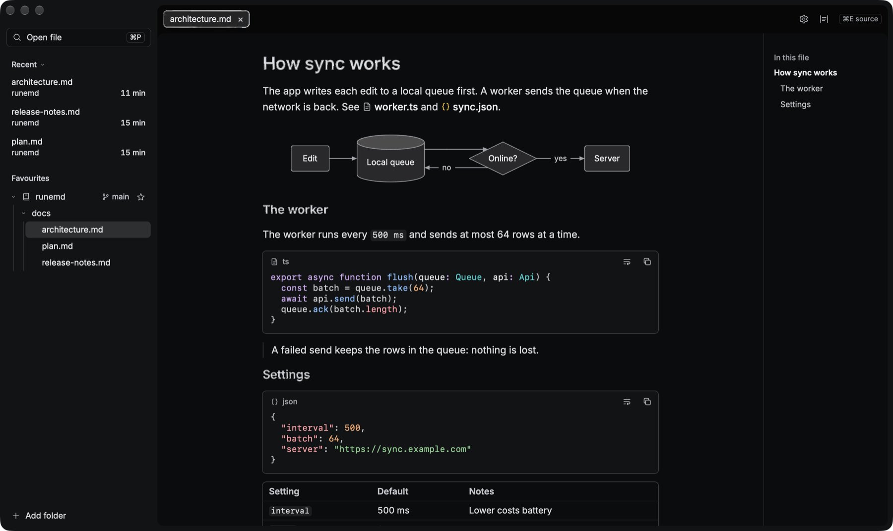
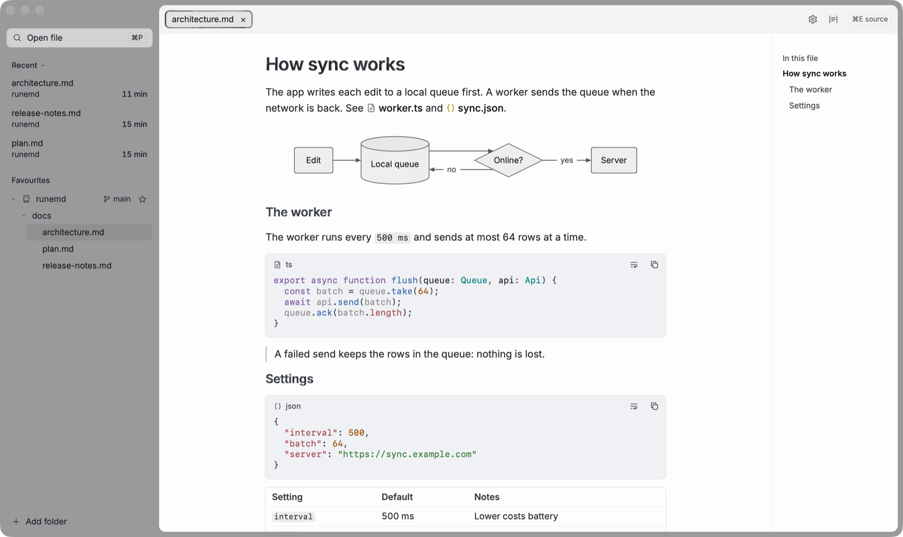

A native Markdown reader for macOS that shows what your agents write, live.

RuneMD opens any Markdown file and reads it with clean typography, tabs, an outline, Quick Open and
Mermaid diagrams. When a coding agent edits a plan, a spec or a README, RuneMD shows the change as it
lands: it marks the file that is being written, points to new text further down, and keeps your place.

It is written in Rust with [Rune](https://github.com/anomalyco/rune) and starts in under 350 ms, also
with 1 MB files.

## Install

1. Download `RuneMD-<version>.zip` from [Releases](../../releases) and open it.
2. Move `RuneMD.app` to Applications.
3. Open it. RuneMD is not signed with an Apple Developer ID yet, so the first time macOS says it cannot
   check the app. Close the message, open System Settings → Privacy & Security, find "RuneMD was
   blocked" and click **Open Anyway**.
4. To open all `.md` files with RuneMD: in Finder, "Get Info" on a `.md` file, "Open with" RuneMD,
   "Change All…".

Requires macOS 26 or later on Apple silicon.

## Features

- **Reading.** Virtualized scroll, tabs, an outline of the headings, tables you can copy, code with
  syntax colours, Mermaid diagrams.
- **Finding files.** A sidebar with Recent files and the folders of the file's repo, Quick Open (⌘P),
  Find in file (⌘F), favourite folders.
- **Live signals while an agent writes.** A metal ring on the file that is being written, fire when new
  text lands further down, dither while a block arrives. With macOS "Reduce motion" they stay still.
- **Editing.** A source view (⌘E) whose save checks for conflicts with the file on disk. If a save fails
  when you quit, the text goes to a recovery copy and opens again at the next start.
- **Settings (⌘,).** Watched folders, font, size, light or dark theme, the bottom fire (Off, Brief or
  Always).

## Opening files

- Finder: double click or "Open With". Several files open in one tab each.
- Terminal: `open -a RuneMD file.md`.

## Crashes

A crash writes a log to `~/Library/Logs/RuneMD/`. Please attach it to an
[issue](../../issues). Read it first: the error message can quote a few lines of the file you had open.

## Building from source

See [CONTRIBUTING.md](CONTRIBUTING.md).

## License

[MIT](LICENSE)

Fonts: Inter (`assets/fonts/`, [SIL OFL 1.1](assets/fonts/OFL.txt)). The RuneMD wordmark is made of
Outfit 800 glyph outlines (`assets/wordmark/`, `scripts/make_wordmark.py`; no font file ships),
[SIL OFL 1.1](assets/fonts/OFL-Outfit.txt), Copyright 2021 The Outfit Project Authors.
