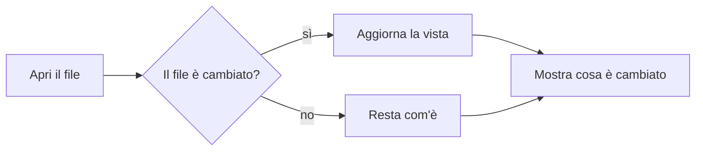
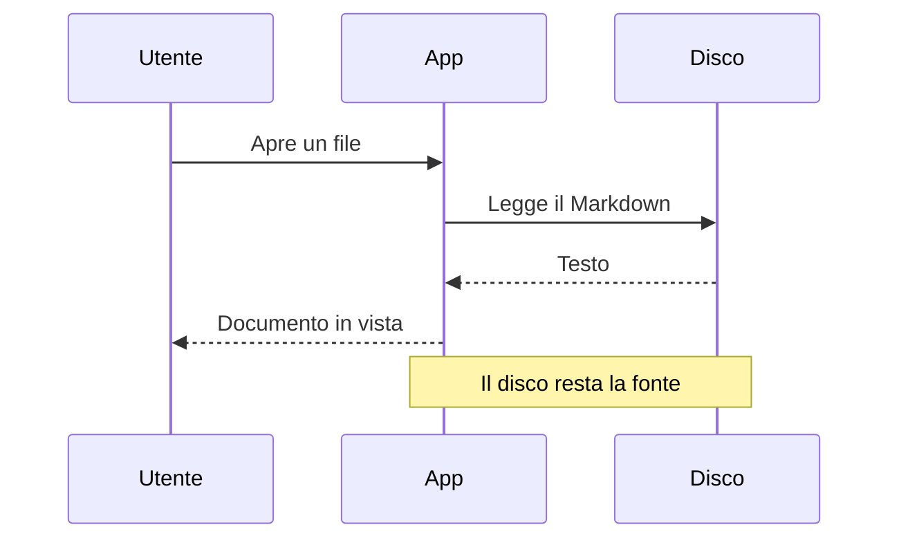

# Diagrammi Mermaid

Un diagramma Mermaid si legge come un'immagine, ma resta testo nel file: il lettore lo disegna con i colori del tema.

## Flusso



## Sequenza



## Non valido

Questo blocco non è un diagramma che il lettore conosce: resta un blocco di codice.

```mermaid
questo non è un diagramma
```

Fine.
